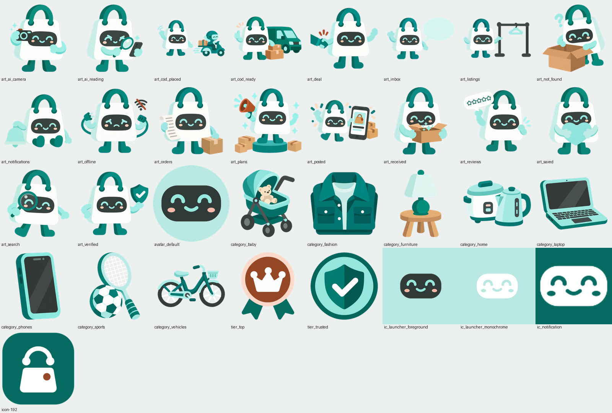

# ShopNexus brand

The mascot drawings, category drawings, tier badges, app icon and logo that
the Android app (`shopnexus/app-android`) and the website (`shopnexus/website`)
both use. Each of them adds this repository as a git submodule at `brand/` and
reads the exported files from it, so a drawing changes in one place.

## Layout

| Path | Holds |
|---|---|
| `masters/` | the source of each asset: 1024 px PNG with transparency, or SVG for the icon, avatar and mark |
| `manifest.json` | one entry per asset: name, master, kind, Android target, whether the web gets it |
| `android/designsystem/res/` | drawables for `core/designsystem`: the art at 640 px WebP in `drawable-nodpi`, `brand_mark.xml` |
| `android/app/res/` | launcher foreground and monochrome PNGs per density for `:app` |
| `android/app-live/res/` | the notification icon for the `live` flavor |
| `web/` | the art as 640 px WebP, `favicon.svg`, `favicon-32.png`, `apple-touch-icon.png`, `icon-192.png`, `icon-512.png` |
| `tools/` | `export.py` writes `android/` and `web/` from the masters; `key.py` cuts a drawing off its background; `preview.py` draws `preview.png` |

The exported files are committed. The app and the website build without
Python or librsvg.

## Changing an asset

1. Replace the master under the same name. A new drawing is generated on a flat
   `#FF00FF` background, because the image model draws transparency with
   noisy edges; `python3 tools/key.py <generated.png> masters/<group>/<name>.png`
   removes the background and centres the drawing on a 1024 px square.
2. For a new asset, add an entry to `manifest.json`.
3. Run `python3 tools/export.py` and `python3 tools/preview.py` (Pillow with
   WebP, and `rsvg-convert`).
4. Commit, then move the submodule pointer in the app and the website.

The drawings were made with gpt-image-2.5 on 2026-11-17, each from the
previous version of the same drawing plus one model sheet of the mascot. The
mascot is the white shopping-bag robot with a teal handle and a charcoal
visor. The palette is teal `#066A61`, mint `#97E7DB` and `#C7E6E0`, charcoal
`#2D3130`, peach blush, and terracotta `#924628` as a small accent.

The launcher face sits inside the central 66 units of the 108-unit
adaptive-icon grid. The monochrome and notification icons are the same visor
in one colour with the face cut out. The mark keeps the geometry of the
earlier `brand_mark.xml`, which the app's loading indicator traces.
